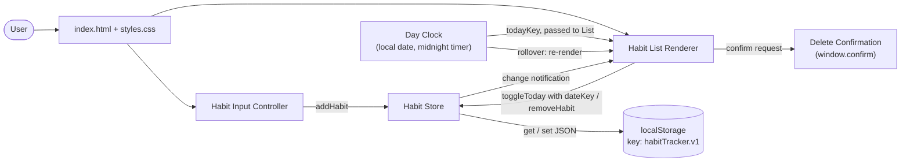
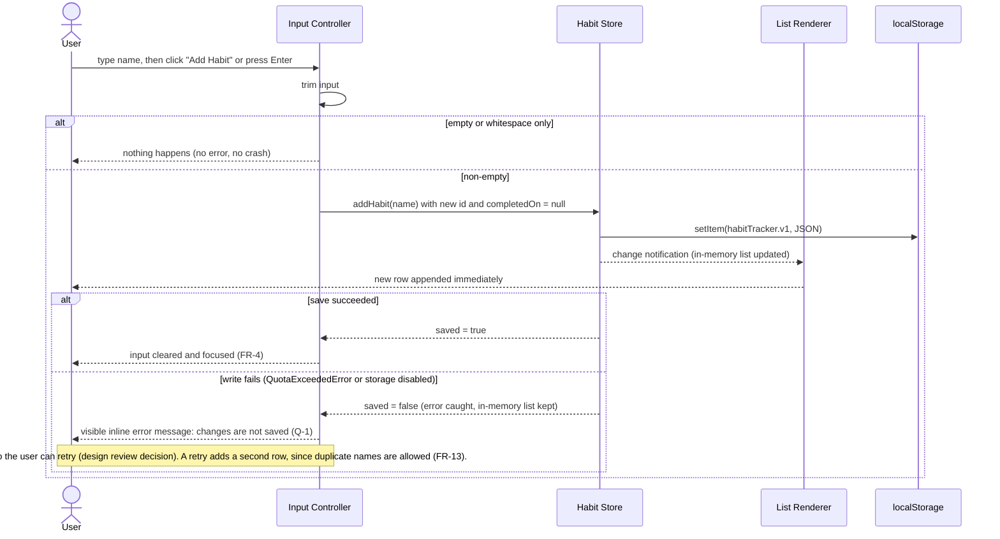
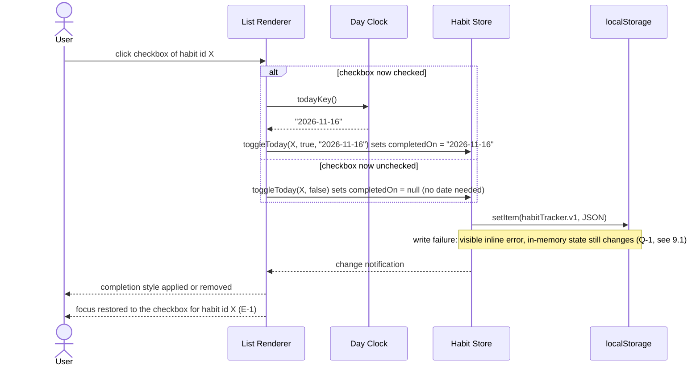
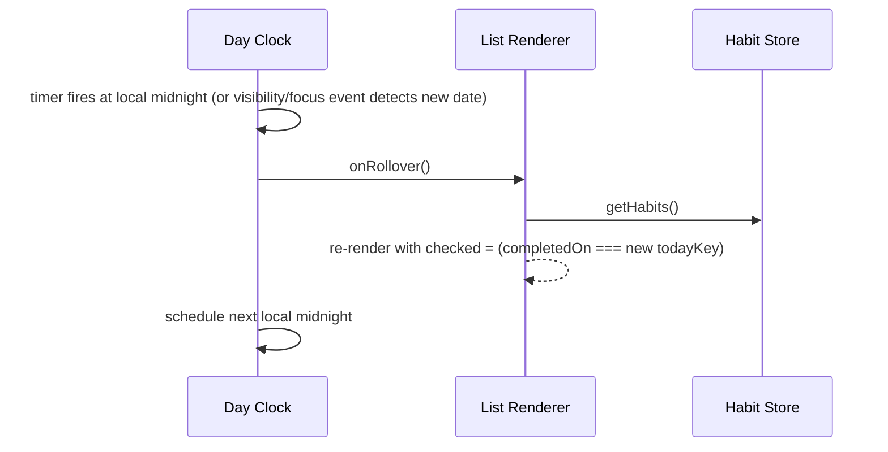

# EPMCDMETST-72536: Static Web Page UI

| Field | Value |
|---|---|
| Stage | 2 - Architecture |
| Source requirements | [01-requirements.md](01-requirements.md) (stage `completed`, approved 2026-11-16T21:45:08+05:30; not modified) |
| Date | 2026-11-16 |
| Confluence page | **not created**. Publication was intentionally disabled for this run (skill step 3 and the Confluence-publishing constraint are commented out in `.github/agents/system-architecture-designer.agent.md`). No page was published and no Confluence link exists. |
| Status | Approved by the human owner. Q-1 decision applied (visible inline error on save failure). |

## 1. Source Requirement IDs

This design covers every approved requirement. IDs were checked against `01-requirements.md`.

- **Functional:** FR-1, FR-2, FR-3, FR-4, FR-5, FR-6, FR-7, FR-8, FR-9, FR-10, FR-11, FR-12, FR-13
- **Non-functional:** NFR-1, NFR-2, NFR-3, NFR-4, NFR-5, NFR-6
- **Acceptance criteria:** AC 1.1 to 1.4, AC 2.1 to 2.4, AC 3.1, AC 3.2 (updated), AC 4.1, AC 4.2 (updated), AC 4.3, AC X.1, AC X.2
- **Assumptions and constraints carried in:** A-1, A-2, A-3, A-4, C-1, C-2, C-3
- **Open items handled as assumptions in this run:** OI-1, OI-4, OI-5, OI-7 (see section 13)
- **Resolved at requirements approval:** OI-2, OI-3, OI-6 (applied in FR-3, FR-2, FR-12)

## 2. Scope and Exclusions

**In scope:** a single static page that lets a user add habits, check or uncheck today's completion, delete a habit after confirmation, and persist all of this in browser localStorage with a daily completion reset.

**Out of scope (from requirements section 7):**
- Streak counter (answer 2)
- Clear or reset of all local data (answer 3)
- Jira `customfield_35221` (answer 9)
- Backend database, external APIs, user accounts, cross-device sync
- Editing an existing habit name
- Browsers other than the latest evergreen Chrome, Edge, Firefox, and Safari
- Formal WCAG conformance testing

## 3. Required Behavior vs. Recommendation vs. Assumption

- **Required behavior** is taken only from the approved requirements. Each design element cites its FR, NFR, or AC.
- **Recommendation** is the proposed design, with rationale and trade-offs in section 6. It is not a requirement.
- **Assumption** is marked **[Assumed]**. It fills a gap in the requirements and needs human confirmation.

## 4. Recommendation Summary

Build the page as a **client-side, zero-dependency static bundle**: one HTML file, one CSS file, and one classic JavaScript file. Keep all habit state in a single localStorage key. Store each habit's completion as the **local calendar date** on which it was checked (or `null`). A habit shows as checked only when that date equals today's local date. This gives the daily reset (FR-12, AC 4.3) without any scheduled cleanup job, and it leaves stale data harmlessly ignored. A small day-clock module triggers re-rendering at local midnight. Delete uses the browser's native confirmation dialog **[Assumed, OI-7]**.

## 5. Deployment Boundaries

- **Runtime:** the user's browser only. The page is served as static files, or opened from disk. No server-side code is required (C-1, NFR-3).
- **Network:** no runtime network calls. No CDN, no external fonts, no external scripts (NFR-2, NFR-3). All assets are local.
- **Persistence:** browser localStorage, scoped to the page's origin. Data lives on one browser profile and one device (A-1, NFR-3).
- **Build:** none required. The three files are authored directly. Any build step is a recommendation only.
- **Hosting location in this repo:** not specified by the requirements. Choosing it is left to the implementation plan.

### 5.1 Origin caveat for file-based serving [Recommendation]
Load JavaScript as a classic script (`<script src="..." defer>`), not as an ES module. Chromium blocks module scripts loaded from `file://`, so an ES-module build may fail when the page is opened directly from disk. This matters because the page has no server (C-1).

## 6. Technology Choices, Rationale, and Trade-offs

| Choice | Rationale | Trade-offs |
|---|---|---|
| Plain HTML5, CSS3, and vanilla ES2017-level JavaScript | Required by NFR-2 and C-1. Runs in all listed evergreen browsers without transpiling. | No component model or built-in state management. The team writes the rendering and state code itself. The codebase stays small. |
| Classic script, not ES module (section 5.1) | Works from `file://` and from a static host. | Globals must be scoped (for example, a single IIFE or namespace object). |
| `localStorage` (single JSON key) | Matches NFR-3 and A-1. Synchronous API, simple, and no library. | About 5 MB per origin in typical browsers, string values only. Not a limit set by requirements, but a real browser constraint (see R-1). |
| Stable per-habit `id` (generated at add time) | FR-13 allows duplicate names, so names cannot serve as keys. Each row must act independently. | Needs an ID generator. `crypto.randomUUID` may be unavailable outside secure contexts. A timestamp plus random suffix is sufficient for a single-device list **[Recommendation]**. |
| Completion stored as local date string `YYYY-MM-DD` on each habit | Implements FR-12 and AC 4.3 directly. "Checked today" becomes one string comparison. Stale dates need no purge job, which fits A-3. | A habit cannot record history. This is intentional (A-3, no completion history). |
| Full re-render of the list from state after each change | Simple, correct, and cheap for a personal list. Avoids stale DOM bugs. | Focus must be restored deliberately after re-render (sections 9.1 to 9.3, E-1). |
| Native `window.confirm()` for delete **[Assumed, OI-7]** | Meets FR-9 with no extra UI code and no dependency. The browser provides accessible dialog behaviour by default. | Styling cannot be controlled. Some browsers let users suppress repeated dialogs, which would make confirm return false and block deletion (R-4). |
| Text "Delete" button with an accessible name that includes the habit name **[Assumed, OI-4]** | Meets FR-8 and AC 3.1. Avoids emoji rendering differences. With duplicate names (FR-13), the accessible name keeps each row distinct. | Slightly more visible text per row. An icon with a label would also be valid. |

## 7. Component Diagram



## 8. Key Components

| Component | Responsibilities | Interfaces | Owned data |
|---|---|---|---|
| **Page shell** (`index.html`, `styles.css`) | Centred card, max-width about 600px, responsive layout, labels, empty-state region, list container, and a visible inline error region (`role="alert"`) for failed saves (Q-1). | Loads the script after the DOM. No runtime APIs. | None. |
| **Habit Input Controller** | Reads the input. Trims text. Ignores empty or whitespace-only names silently. Handles Add button and Enter key. Clears and refocuses the input after a successful add. | Calls `Store.addHabit(name)` and reads the returned `saved` flag. Does not call the renderer directly; the Store's change notification triggers the re-render. | The current text in the input field only. Not persisted. |
| **Habit List Renderer** | Renders one row per habit: checkbox, name, Delete button. Applies the completion style. Shows the empty-state message when the list is empty. Asks for confirmation before delete. | Reads `Store.getHabits()`. Gets `dateKey` from `Clock.todayKey()` at render time and at each check action, and passes it explicitly: `Store.toggleToday(id, checked, dateKey)`. Calls `Store.removeHabit(id)`. Subscribes with `Store.subscribe(listener)`. Restores focus to the checkbox for habit `id` after re-render (E-1). | No persistent data. DOM only. |
| **Habit Store** | Single source of truth in memory. Loads and validates the JSON on page load. Writes the full object to localStorage after every add, check, uncheck, or delete. Falls back to an empty list when stored data is missing or unreadable (unreadable data is backed up first, and duplicate IDs are regenerated on load; see section 10). If storage is unavailable at load, the page shows the inline warning on load (section 13.1(c)). If a write fails (quota exceeded or storage disabled), it keeps the in-memory change and reports the failure so the page shows a visible inline error (Q-1). | `getHabits()`, `addHabit(name)` (returns `{saved}`), `toggleToday(id, checked, dateKey)` (`dateKey` is required when `checked` is true; the Store never reads the clock), `removeHabit(id)`, `subscribe(listener)` (called after every in-memory change, whether or not the save succeeded). | `habitTracker.v1` localStorage key, and the backup key in section 10. |
| **Day Clock** | Computes the local calendar date as `YYYY-MM-DD`. Schedules a timer for the next local midnight. Triggers a re-render at rollover. Rechecks on `visibilitychange` and `focus` to correct for timer drift or sleep. | `todayKey()`, `onRollover(callback)`, `now()` (injectable time source; defaults to the real clock and is replaced in tests, E-7). The Day Clock is the only component that reads the wall clock. | None. Holds only the timer handle. |
| **Delete Confirmation** | Shows the native confirm dialog. Returns true or false. | `confirm(message)`. | None. |

## 9. Sequence Diagrams

### 9.1 Add habit (FR-1, FR-2, FR-3, FR-4, FR-10, FR-13, AC 1.2 to 1.4, AC X.1)



### 9.2 Check or uncheck today (FR-5, FR-6, FR-10, AC 2.1 to 2.3)



### 9.3 Delete habit with confirmation (FR-8, FR-9, FR-10, AC 3.1, AC 3.2)

```mermaid
sequenceDiagram
  actor U as User
  participant L as List Renderer
  participant D as Delete Confirmation
  participant S as Habit Store
  participant LS as localStorage
  U->>L: click "Delete" on habit id X
  L->>D: confirm("Delete <name>?")
  alt user confirms
    D-->>L: true
    L->>S: removeHabit(X)
    S->>LS: setItem(habitTracker.v1, JSON)
    note over S,LS: write failure: visible inline error, row still removed in memory (Q-1, see 9.1)
    L-->>U: row removed from DOM; focus moves to the Add input
  else user cancels
    D-->>L: false
    L-->>U: no change
  end
```

### 9.4 Page load with daily reset (FR-11, FR-12, AC 4.2, AC 4.3, A-2, A-3)

```mermaid
sequenceDiagram
  participant P as Page
  participant S as Habit Store
  participant LS as localStorage
  participant C as Day Clock
  participant L as List Renderer
  P->>S: load()
  S->>LS: getItem(habitTracker.v1)
  alt missing or unreadable
    S-->>P: empty list (no crash)
  else valid
    S-->>P: habits with stored completedOn values
  end
  P->>C: todayKey(), schedule midnight timer
  P->>L: render
  note over L: checked = (completedOn === todayKey)<br/>stale dates show unchecked; data is not rewritten
```

### 9.5 Midnight rollover while the page stays open (FR-12, AC 4.3, OI-6 resolved)



## 10. Data Model and Data Store

**Store:** browser localStorage, single active key `habitTracker.v1` **[Recommendation]**, plus one backup key `habitTracker.v1.backup`. The backup key is written only when stored data is unreadable (E-4).

```json
{
  "version": 1,
  "habits": [
    { "id": "m3x9k2a1b", "name": "Drink water", "completedOn": "2026-11-16" },
    { "id": "m3x9k7q4z", "name": "Read 10 pages", "completedOn": null }
  ]
}
```

| Field | Type | Rule |
|---|---|---|
| `version` | integer | Fixed at `1`. Supports a future migration. |
| `habits[]` | array | Order is insertion order. Duplicate names allowed (FR-13). No maximum count (NFR-6). |
| `id` | string | Unique per habit. Generated at add time. Never derived from the name. |
| `name` | string | Non-empty after trim (FR-3). No maximum length (NFR-6). Stored as text, never as HTML. |
| `completedOn` | string or null | `YYYY-MM-DD` in the user's local time zone (A-2). Set to today on check and to `null` on uncheck. Checked for display only if equal to today. |

**Read rules:**
- A habit is displayed as checked only if `completedOn === todayKey`.
- Entries with an older date are kept, not purged, and treated as unchecked (A-3, OI-5 assumption).
- If the key is missing or empty, the store starts empty.
- If the key holds a value that is not valid JSON or has an unexpected top-level shape, the store copies the raw string to `habitTracker.v1.backup` before any write, but only if the backup key is not already set. Later loads never overwrite the backup. The store then starts empty. If the backup write fails, the page still starts empty and no further backup is attempted. The page never throws to the user (see R-3).
- If two habits share the same `id`, the later duplicate receives a newly generated `id` on load. The corrected IDs are saved with the next write. Duplicate names remain allowed (FR-13).

**Write rules:** every add, check, uncheck, and delete writes the full object (FR-10). A midnight rollover does **not** write. If a write fails (quota exceeded or storage disabled), the in-memory list keeps the change, the user sees a visible inline error stating that changes are not saved (Q-1 decision), and the unsaved change is lost on reload. The inline error clears on the next successful save **[Recommendation]**. For an add that fails to save, the input keeps its text and is not cleared (section 9.1).

**Owned data:** all habit data is owned by the Habit Store. No other component writes to either key.

## 11. Integrations

- **None at runtime.** No backend APIs, no third-party scripts, no analytics, no external fonts (NFR-2, NFR-3, C-1).
- **Jira** is the source of requirements only. It is not an integration of the running product.
- **Confluence:** not used in this run. No page was created or verified.

## 12. Trust Boundaries

| Boundary | Trust | Design control |
|---|---|---|
| User input → page | Untrusted. Habit names are arbitrary text, possibly including HTML. | Render names with `textContent`, never `innerHTML`. Trim and reject empty names. Apply no other transformation. |
| Page → localStorage | Same-origin and shared with any script on the same origin. Data is not secret. | Store no credentials, tokens, or personal identifiers beyond habit names. Validate on read. |
| Stored data → page on load | Untrusted if corrupted or edited by another script. | Parse in a try block. Validate types (`habits` is an array of objects with string `id` and `name`, and `completedOn` is string or null). Drop invalid entries. Whole-key corruption is backed up and duplicate IDs are regenerated, as in section 10. |
| Page → browser dialog | Trusted UI provided by the browser. | None beyond boolean handling. |
| Other tabs on the same origin | Can write the same key. | Single tab per origin is assumed (section 13.2, DR-02, confirmed). No cross-tab sync is in the design. If several tabs are open, the last write wins (R-5). |

No authentication, authorization, or network trust boundary exists in this design. No secrets are handled.

## 13. Clarified Decisions and Assumptions

### 13.1 Clarified decisions (binding, from requirements)
- **Daily completion reset** (answer 4, FR-12, AC 4.2 updated, AC 4.3): checked state is per local calendar date.
- **Confirmation before delete** (answer 8, FR-9, AC 3.2 updated).
- **Duplicate names allowed** (answer 7, FR-13, AC X.1).
- **No length or count limits** (answer 7, NFR-6, C-3).
- **Browser targets: latest evergreen Chrome, Edge, Firefox, Safari** (answer 5, NFR-5, C-2).
- **Accessibility: spec wording, no WCAG target** (answer 6, NFR-4).
- **Resolved at approval:** OI-2 (silent ignore of empty input, FR-3), OI-3 ("Add Habit" label, FR-2), OI-6 (local midnight reset, FR-12, AC 4.3).
- **Save failure message (Q-1, resolved by human decision):** when a localStorage save fails (quota exceeded or storage disabled), the page shows a **visible inline error message** that tells the user changes are not saved. The in-memory list keeps working. The error is shown in the page shell's inline error region (section 8), and the write-failure paths in sections 9.1 to 9.3 and the write rules in section 10 apply.

- **Design review decisions (PENDING-1 to PENDING-3, confirmed by the human owner, 2026-11-16):** (a) single tab per origin is assumed (section 13.2, DR-02). (b) For an add that fails to save, the row appears, the inline error shows, and the input text is kept. The input is cleared only after a successful save, as FR-4 states. (c) When storage is disabled, the page does not persist data and shows only the inline warning (R-2). **Load-time warning (human decision, 2026-11-16 implementation stage):** the inline warning is shown on page load when storage is unavailable at startup (the storage read throws), so the user sees it before making any change. It is also shown after a failed write, as in (b). The warning clears on the next successful save, the same as for a failed write. No new requirement ID or section is added.

### 13.2 Open items handled as assumptions (not blocking)

| ID | Open item | Assumption used in this design | Design impact if the assumption is wrong |
|---|---|---|---|
| **OI-1** | Jira export mismatch: Type is blank (script reads the wrong key), and Labels are blank (payload has no `labels` key). | **[Assumed]** Requirements content is correct as approved. The blank Type and Labels fields come from the export tooling, not from the product. They do not change any design decision. The export script is not changed in this stage. | None on the product design. Only the requirements header metadata would change. |
| **OI-4** | Delete control: icon (🗑️) or "Delete" text. | **[Assumed]** Visible text button labelled **"Delete"**, with an accessible name of `Delete <habit name>` for each row (`aria-label`). | Low. Changing to an icon means changing the markup and keeping the same accessible name. Behaviour and data are unchanged. |
| **OI-5** | Stale completion data: purge old entries from localStorage, or keep them and ignore them (A-3)? | **[Assumed]** Keep and ignore. Stale `completedOn` values are never purged. The data model (section 10) already makes them harmless. | Low. A purge step on load could be added as a small change to the store. No change to the reset logic. Storage growth is one date string per habit. |
| **OI-7** | Confirmation prompt form: native browser dialog or in-page modal. | **[Assumed]** Native `window.confirm()` with a message that names the habit. | Medium. An in-page modal would need focus trap, Escape handling, and screen-reader labelling. Changes are limited to the Delete Confirmation component. Data and interfaces stay the same. |
| **DR-02** (confirmed, PENDING-1) | Multiple tabs on the same origin: is cross-tab handling needed? | **[Confirmed by human owner]** Single tab per origin is assumed. The design has no re-read before write and no `storage` event listener. | If two tabs are open, a stale tab can overwrite another tab's add or delete on its next write (R-5). Changing this means adding a re-read before each write, or a `storage` event listener, in sections 9.1 to 9.3 and 10. |

## 14. NFR Coverage

| NFR | How the design covers it | Status |
|---|---|---|
| NFR-1 Centred card, max-width about 600px, responsive | Page shell CSS: centred container with `max-width: 600px`, fluid width, and a mobile-friendly layout using relative units. Long names wrap rather than overflow. | Covered by design. Not yet verified in a browser. |
| NFR-2 No frameworks, no CSS libraries unless local | Plain HTML, CSS, and JS only (section 6). No package or CDN dependency. | Covered by design. |
| NFR-3 Client-side only, localStorage only | Store is localStorage. No runtime network calls (section 11). | Covered by design. |
| NFR-4 Labels, keyboard navigation | Input has a visible or `aria-label`. Each checkbox is a native `<input type="checkbox">` with a `<label>` containing the habit name. Delete is a native `<button>` with an accessible name. Enter key submits the add form. Focus is restored after add (section 9.1), after check and uncheck (section 9.2, E-1), and after delete (section 9.3). The save-failure error is a visible text region with `role="alert"`, so screen readers announce it (Q-1). The completion style does not rely on colour alone (strike-through, FR-6). | Covered by design. Not formally tested (no WCAG target). |
| NFR-5 Latest evergreen Chrome, Edge, Firefox, Safari | Uses only standard APIs: localStorage, `Date`, `addEventListener`, `window.confirm`, and `setTimeout`. No transpilation needed. | Covered by design. Browser testing is still required. |
| NFR-6 No limits | No max length or count checks. Unbounded input is accepted by the design. The real storage ceiling is a browser constraint (R-1). | Covered by design, with risk R-1. |

No performance targets were given. None are stated here.

### 14.1 FR traceability (E-5)

| FR | Design element | Section |
|---|---|---|
| FR-1 | Page shell input with placeholder | 8 |
| FR-2 | Input Controller; Store `addHabit` | 8, 9.1 |
| FR-3 | Input Controller (trim; silent ignore of empty input) | 8, 9.1 |
| FR-4 | Input Controller (clear and focus only after a successful save) | 8, 9.1 |
| FR-5 | Renderer (checkbox and name per row) | 8 |
| FR-6 | Renderer (completion style, strike-through) | 8, 9.2 |
| FR-7 | Renderer (empty-state region) | 8 |
| FR-8 | Renderer (Delete button with accessible name) | 6, 8 |
| FR-9 | Delete Confirmation; Renderer; Store `removeHabit` | 8, 9.3 |
| FR-10 | Store (full write on every change) | 9.1 to 9.3, 10 |
| FR-11 | Store (load and validate) | 9.4, 10 |
| FR-12 | Day Clock; Renderer; Store `completedOn` | 9.4, 9.5, 10 |
| FR-13 | Store (per-habit `id`; duplicate names allowed) | 9.1, 10 |

### 14.2 Verbatim texts (A-4, E-5)

| Element | Text | Source |
|---|---|---|
| Input placeholder | `Enter a new habit...` | FR-1, AC 1.1 |
| Add button | `Add Habit` | FR-2, AC 1.2, OI-3 |
| Empty-state message | `No habits added yet. Start by adding one above!` | FR-7, AC 2.4 |
| Delete control | `Delete` | FR-8, AC 3.1, OI-4 |

## 15. Risks

| ID | Risk | Likelihood / impact | Mitigation |
|---|---|---|---|
| R-1 | localStorage quota (about 5 MB per origin in typical browsers) can be exceeded. Under NFR-6 there is no limit, so a save can fail with `QuotaExceededError`. | Low / medium | Catch write errors. Keep the in-memory list correct. Show a visible inline error message (Q-1 decision). |
| R-2 | Storage access can throw in some privacy modes, for example Safari private windows or when storage is disabled. | Low / high | Wrap all storage access in try/catch. Start empty and keep the page usable. Persistence is then unavailable. The visible inline error tells the user that changes are not saved, shown on page load when storage is unavailable at startup and after any failed write (Q-1 decision, section 13.1(c)). |
| R-3 | Corrupted or hand-edited localStorage data. | Low / medium | Validate on load and drop invalid entries (section 12). Never throw from the render path. |
| R-4 | Some browsers let the user suppress repeated dialogs. `confirm()` then returns false, and delete cannot proceed. | Low / low | Accept as browser behaviour. If it is a problem, switch to the in-page modal (OI-7 reversal). |
| R-5 | Two tabs on the same origin write the same key. The last write wins, and one tab's changes can be overwritten. | Medium / low | Single tab per origin is assumed (section 13.2, DR-02, confirmed). Optional `storage` event listener could refresh other tabs. Not in scope unless requested. |
| R-6 | Timer drift or sleep means the midnight rollover fires late. | Medium / low | Recheck the date on `visibilitychange` and `focus`, and on every render (section 8, Day Clock). |
| R-7 | Stale completion dates accumulate (OI-5). | Low / low | One short string per habit. Purge can be added later (section 13.2). |
| R-8 | Focus is lost after re-rendering the list. This hurts keyboard users. | Medium / medium | Explicit focus handling after add (to input), after check or uncheck (to the same habit's checkbox, E-1), and after delete (to Add input). Covered in sections 9.1 to 9.3. |
| R-9 | The text "Delete" plus the habit name in the accessible name could be verbose for screen readers. | Low / low | Acceptable. Matches the duplicate-name requirement. |
| R-10 | Names containing HTML or script. | Low / high if mishandled | `textContent` only, as in section 12. |

## 16. Open Questions

These need an answer before implementation. They do not block this architecture.

- **Q-1 (resolved):** When a save fails (quota or storage disabled), the user sees a visible inline error message that changes are not saved. The in-memory list keeps working. Resolved by human decision (section 13.1).
- **OI-1, OI-4, OI-5, OI-7:** still open for the human owner. Assumptions are in section 13.2. Each one can be changed without changing the requirements.

## 17. Verification and Traceability

- Every requirement ID cited in this document was checked against `01-requirements.md` (section 1).
- The design is local. **No Confluence page exists, so there is no published design to compare against.** The diagrams in sections 7 and 9 are the design of record for this run.
- **Test approach (E-7):** unit tests use the Day Clock's injectable `now()` to cover: midnight rollover (timer fires, and a check at 23:59:59 is stored under the displayed date); recheck on `visibilitychange` and `focus`; a stale `completedOn` shown as unchecked on load; add and toggle with a failing write (quota exceeded and storage disabled), showing the inline error and keeping the input text after a failed add; unreadable stored data backed up before the first write; duplicate IDs regenerated on load. Browser runs in the NFR-5 browsers are still required.
- **Verification limitations:** no browser run, no test execution, no code exists yet, and no Confluence page was published or read back. Behavioural claims are design intentions until implementation and browser testing confirm them.

## 18. Approval Status

- Stage: `architecture`
- Recorded status: `completed` (see `Docs/EPMCDMETST-72536/pipeline-state.json`)
- Approved by the human owner. The Q-1 decision (visible inline error on save failure) has been applied. Confluence was not created, so there is no published page.
- Design review (`03-design-review.md`, 2026-11-16): E-1 to E-7 applied at the human owner's direction. PENDING-1 to PENDING-3 recorded as resolved (sections 13.1 and 13.2). Design review approved. Implementation planning has not started.
