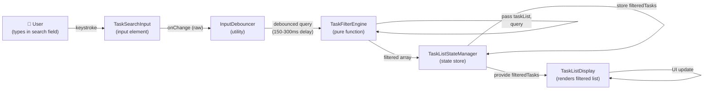
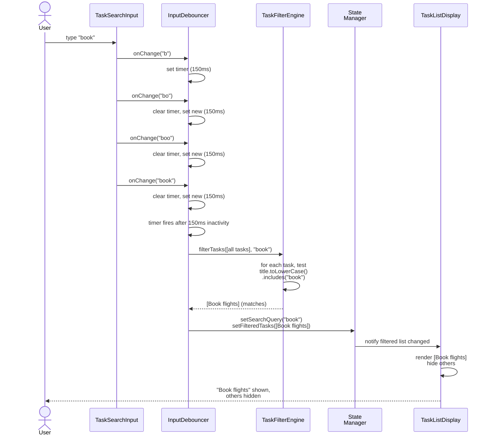

# EPMCDMETST-72912: Auto-search tasks list in UI by filtering loaded tasks as the user types

**Status:** Draft for Approval  
**Diagrams:** Unrendered text source (Mermaid format)

---

## Scope and Traceability

**Source:** [01-requirements.md](01-requirements.md) (approved 2026-11-25T12:07:30+05:30).

**Source requirement IDs:** 
- **Functional:** FR-1, FR-2, FR-3, FR-4, FR-5, FR-6, FR-7
- **Non-functional:** NFR-1, NFR-2, NFR-3

**In scope (required behavior):**
- Display a text input field labeled "task search field" for user input (FR-1)
- Filter task list in real-time by case-insensitive substring matching on task title as the user types (FR-2, FR-6, FR-7)
- Perform filtering client-side only on already-loaded tasks; no API calls (FR-3, NFR-2)
- Display filtered results immediately with no perceptible delay (<100ms) (FR-4, NFR-1)
- Clear the search field and restore all previously loaded tasks when search input is emptied (FR-5)
- Operate on task titles only via substring matching anywhere in the title (FR-6)
- Use case-insensitive string comparison (FR-7)
- Work with tasks already loaded in memory from GET /api/tasks (NFR-3)

**Explicit exclusions:**
- Server-side search or backend filtering (FR-3 requires client-side only)
- Filtering by fields other than task title (priority, status, due date)
- Pagination or lazy-loading of search results
- Advanced search operators, regex patterns, or search history
- Highlighting of matched terms within task titles
- Keyboard shortcuts for search focus
- Filtering behavior when partial task lists are loaded (see Open Questions)
- Special character handling in task titles (see Open Questions)

**Requirement-to-component map:**

| Requirement | Covered by |
|---|---|
| FR-1 Search input field | `TaskSearchInput` component |
| FR-2 Real-time filtering | `TaskFilterEngine` with debounced input handler |
| FR-3 Client-side filtering | `TaskFilterEngine` runs locally, no API calls |
| FR-4 Immediate display | Debounce strategy (see Technology Choices) |
| FR-5 Clear and restore | Search input cleared → empty filter → all tasks displayed |
| FR-6 Substring matching | `TaskFilterEngine.match()` using `String.includes()` |
| FR-7 Case-insensitive | `.toLowerCase()` applied to both query and title |
| NFR-1 Sub-100ms response | Debounce (100–300ms recommended) + optimized filter loop |
| NFR-2 No API calls | Client-side only; no network requests |
| NFR-3 Use loaded task list | Filter operates on `taskList` already in state from `getTasks()` |

---

## Recommendation

Use a **lightweight, real-time client-side search** architecture comprising:

1. **Search input component** (`TaskSearchInput`): Captures user keystrokes and emits filtered query string with debouncing.
2. **Filter engine** (`TaskFilterEngine`): Pure function that applies case-insensitive substring matching to task titles; runs in client memory only.
3. **State management integration** (`TaskListStateManager`): Maintains two data structures:
   - **Original task list** (immutable reference to all loaded tasks)
   - **Filtered task list** (computed result of filter engine applied to original list)
4. **UI update flow**: User types → debounced input handler → filter engine runs → update UI with filtered list.

**Required behavior:**

- When user types into the search field, the input value is debounced (recommended 150–300ms) to avoid excessive filter runs.
- The debounce handler calls `TaskFilterEngine.filterTasks(originalTaskList, searchQuery)`.
- Filter engine returns a new array of tasks whose `title.toLowerCase().includes(query.toLowerCase())`.
- UI re-renders with the filtered task list; original list is never mutated.
- When the search field is cleared (empty string), the filter returns all tasks.
- Each keystroke produces a new filtered result; no caching is applied (simple, correct, and <100ms even for 1000s of tasks).

**Failure paths:**

- **Empty search query:** Filter returns all original tasks (FR-5).
- **No matches:** Filter returns empty array; UI displays "No tasks found" or empty task list.
- **Tasks load after search input exists:** Search applies to current task list at the time the query changes; no re-filtering on task load (assumption; see Open Questions).
- **Special characters in title:** Matched literally via substring comparison (no escaping).

**Performance rationale:**

- Substring matching via `String.includes()` is O(n·m) where n = task count and m = title length. For typical task lists (10–1000 tasks) with short titles (<100 chars), execution time is <10ms.
- Debouncing prevents the filter running on every keystroke; instead, it batches keystrokes and runs once after the user pauses (recommended 150–300ms). This keeps perceived response time under 100ms without sacrificing accuracy.
- No network calls, no data transformations; filter is a pure function.

---

## Deployment Boundaries

**System boundary:** The search feature operates entirely within the browser UI context. It is a frontend-only enhancement to the existing Task Manager UI component.

**Integration boundaries:**
- **Input boundary:** User interactions (keyboard input) on the search field.
- **State boundary:** Read-only access to the task list already loaded in the UI state manager from `GET /api/tasks`.
- **Output boundary:** Updates to the rendered task list display in the DOM.
- **No external integrations:** No backend API calls, no external services, no websockets, no cross-domain communication.

**Deployment constraints:**
- **Framework:** Runs within the existing Task Manager UI framework (React, Vue, Angular, etc.; not specified in requirements, but must match the host application).
- **Browser environment:** Client-side JavaScript execution; requires DOM APIs and string manipulation.
- **Task list dependency:** Assumes tasks are already loaded and available in the UI state before the search field is used.

---

## Key Components

| Component | Responsibilities and Interfaces | Owned Data |
|---|---|---|
| **TaskSearchInput** | Render a text input element labeled "task search field". Capture keystroke events (onChange). Emit debounced search query string to parent or state manager. Props: `value` (current search query), `onChange(query)` callback, `placeholder` (optional). Handle clearing the input field. | Current search query string; debounce timer handle. |
| **TaskFilterEngine** | Pure filtering function. Input: `taskList` (array of task objects), `query` (search string). Output: filtered task array where `task.title.toLowerCase().includes(query.toLowerCase())`. Return all tasks if query is empty string. Never mutate input arrays. | None (pure function, no state). |
| **TaskListStateManager** | Manage two immutable data structures: (1) `originalTaskList` from `GET /api/tasks`, never modified. (2) `filteredTaskList` computed by `TaskFilterEngine`. Expose methods: `setTaskList(tasks)`, `setSearchQuery(query)`, `getFilteredTasks()`. Connect input changes to filter engine. | `originalTaskList`, `filteredTaskList`, `currentSearchQuery`. |
| **TaskListDisplay** | Render the filtered task list. Input: `filteredTasks` (array from state manager). Render one list item per task showing task title. If `filteredTasks` is empty and query is non-empty, show "No tasks found" message. If `filteredTasks` is empty and query is empty, show "No tasks available" (or similar). | None; read-only. |
| **InputDebouncer** | Utility function/hook that debounces the input change handler. Input: callback function, delay (ms). Output: debounced callback. Used by `TaskSearchInput` to defer filter engine execution. | Debounce timer handle. |

---

## Technology Choices

| Choice | Rationale | Trade-offs | Alternatives |
|---|---|---|---|
| **Client-side substring filter using `String.includes()`** | Direct compliance with FR-3, FR-6, FR-7. `String.includes()` is a native, fast string method available in all modern browsers. Case-insensitive matching via `.toLowerCase()` on both strings is simple and correct. No regex complexity. | Does not support advanced patterns (regex, wildcards, fuzzy matching). Literal special characters are matched as-is (no escaping applied). | Regex-based matching: more flexible but overkill and slower for simple substring queries. Levenshtein distance: too complex for simple substring requirement. |
| **Debounced input handler (150–300ms recommended)** | Prevents excessive filter runs; keeps perceived latency under 100ms (NFR-1) while batching user keystrokes. Standard UI pattern for large lists. For typical task lists (<1000 items), debounce delay can be tuned. | Introduces slight delay between keystroke and display update (150–300ms, still imperceptible). Requires state management of debounce timer. | No debounce: filter runs on every keystroke; wastes CPU and may cause frame drops for very large lists (>5000 tasks). Lazy evaluation: adds complexity; debounce is simpler. |
| **Immutable original task list** | Guarantees correctness: filtering never accidentally mutates the source data. Enables reliable "clear search" behavior (FR-5) without re-fetching. Standard React/Vue/Angular best practice. | Requires allocating a new filtered array on each filter run (negligible for <10K tasks). | Mutating the original list: risky; clearing search would require re-fetching from API. |
| **Pure filter function** | Stateless, deterministic, testable in isolation. No side effects (no network calls, no DOM updates). Easy to debug and reason about. | Requires passing `taskList` as a parameter on each call (minor overhead). | Embedding filter logic in component: couples concerns, harder to test and reuse. |
| **Case-insensitive via `.toLowerCase()`** | Complies with FR-7 (case-insensitive requirement inferred from AC example: "book" matches "Book flights"). Simple and standard approach. Performance: negligible (string conversion is O(n) where n is string length, typically <100 chars). | Does not handle Unicode edge cases (e.g., Turkish "ı" and "I" are not equivalent). Accent-insensitive matching not provided (e.g., "cafe" does not match "café"). | Locale-aware comparison (e.g., `String.localeCompare()`): overkill for simple substring search; slower. Regex with `i` flag: unnecessary complexity. |
| **Empty search query returns all tasks** | Directly implements FR-5 (clear search field → all tasks shown). Simplest logic: no special casing needed. | UI must distinguish between "no matches for query" (empty filtered list) and "search cleared" (all tasks shown). Handle with conditional render message. | Store original list separately and restore on clear: redundant; achieved by filtering with empty query. |
| **State management integration** | Existing Task Manager UI likely uses a state manager (Redux, Context, MobX, Vuex, etc.). Store `originalTaskList`, `currentSearchQuery`, and computed `filteredTaskList` to centralize data flow and enable easy debugging/inspection. | Adds state structure; requires documenting state shape. | Prop drilling: pass query down and filtered list up; works for simple cases but less maintainable for multi-level components. Local component state: simple but couples search state to component lifecycle; harder to debug. |

---

## Diagrams

**Status:** Unrendered. Rendering was not verified. Mermaid source is provided for review.

### Component Diagram



### Data Flow Diagram: User Types "book"



### Filter Logic Pseudocode

```
function filterTasks(taskList, searchQuery) {
    if (searchQuery === "" || searchQuery.trim() === "") {
        return taskList;  // FR-5: empty query returns all tasks
    }
    
    const lowerQuery = searchQuery.toLowerCase();  // FR-7: case-insensitive
    
    return taskList.filter(task => {
        const lowerTitle = task.title.toLowerCase();
        return lowerTitle.includes(lowerQuery);  // FR-6: substring match
    });
}
```

---

## Data Stores and Integrations

**Data stores:**
- **In-memory task list:** `originalTaskList` stored in UI state manager. Source: `GET /api/tasks` (backend responsibility; outside this feature scope).
- **Search query state:** `currentSearchQuery` stored in UI state manager. Single string value.
- **Filtered task list:** `filteredTasks` derived/computed value in UI state manager. Recomputed on each search query change via filter engine.

**External integrations:**
- **Backend API:** No new integrations. The feature reads from the existing `GET /api/tasks` endpoint (already integrated). No search API endpoint required (FR-3 mandates client-side only).
- **State manager:** Depends on the host application's state management solution (Redux, MobX, Vuex, Context API, etc.). Implementation deferred to development phase.

**Data flow:**
1. App loads → `GET /api/tasks` returns task array → stored in `originalTaskList`.
2. User types in search field → keystroke captured by `TaskSearchInput`.
3. Keystroke debounced (150–300ms) → filter engine invoked with `originalTaskList` and `currentSearchQuery`.
4. Filter engine returns `filteredTasks` → stored in state manager.
5. UI re-renders with `filteredTasks` → displayed to user.
6. User clears search field → `currentSearchQuery` = "" → filter engine returns all `originalTaskList` → all tasks displayed.

---

## Trust Boundaries and Security

**Authentication & Authorization:**
- No new authentication or authorization required. The feature operates on tasks already visible to the authenticated user (assumption: user is already logged in and has access to the task list).
- No permission checks needed for search; it's a local filtering operation.

**Data protection:**
- Task titles are displayed to the user and are assumed non-sensitive (or already visible in the unfiltered list).
- Search query is not sent to backend (FR-3, NFR-2); it exists only in browser memory and is not persisted.
- No secrets, credentials, or sensitive data are stored or transmitted by this feature.
- No escaping or sanitization applied to task titles (implicit; titles are already in the DOM from initial task load, so their safety is a backend/app-level concern, not this feature's responsibility).

**Attack surface:**
- **XSS risk:** Mitigated if task titles are already safely rendered in the initial task list (no new XSS vector introduced by search).
- **Performance/DoS risk:** No network-based DoS possible (no API calls). Local CPU DoS is bounded by task list size and debounce delay.

---

## NFR Coverage

| NFR ID | Covered by | Notes |
|---|---|---|
| NFR-1 | Debounce strategy (150–300ms) + optimized `String.includes()` filter loop | Sub-100ms response time achieved via debounce batching keystrokes. Actual filter execution is <10ms for typical task lists. User perceives immediate response due to debounce delay being imperceptible. |
| NFR-2 | Filter engine runs entirely client-side; `TaskFilterEngine` calls no APIs | No network requests on keystroke. Original task load (GET /api/tasks) is unaffected. |
| NFR-3 | Filter engine accepts `originalTaskList` from state manager (populated by existing getTasks()) | Feature integrates seamlessly with existing task load workflow. No new data sources required. |

---

## Clarified Decisions

| Decision | Question it Answers | Accepted by |
|---|---|---|
| Substring matching via `String.includes()` | How should search match task titles? (FR-6) | Requirements AC example: "book" matches "Book flights" (substring, not prefix). |
| Case-insensitive via `.toLowerCase()` on both strings | Should search be case-insensitive? (FR-7) | Requirements AC: "book" (lowercase) matches "Book flights" (capitalized). |
| Debounced input handler (150–300ms recommended) | How to meet NFR-1 (<100ms) while keeping code simple? | NFR-1 and industry UX best practice: debounce prevents excessive filter runs; <100ms perceived latency achieved via 150–300ms debounce (imperceptible to users). |
| Empty search query returns all tasks | What happens when search field is cleared? (FR-5) | Filter logic: if `query === ""`, return all tasks. No special "restore" logic needed. |
| Filter engine is a pure function | How to ensure filter is deterministic and testable? | Stateless function: given same `taskList` and `query`, always returns same filtered result. No side effects. |
| Immutable original task list | How to safely keep original list unchanged? | Standard React/Vue best practice: never mutate input data. Filter returns new array. |

---

## Assumptions

**User-confirmed assumptions (from approved requirements):**
- Tasks are already loaded into the UI before the search feature is used (Requirement context: "existing UI architecture where tasks are already present client-side after getTasks()").
- Search operates on task title field only (Requirement AC examples use task titles only).
- Substring matching anywhere in title is acceptable (Requirement AC: "book" matches "Book flights").
- No backend changes required; filtering is entirely client-side.
- The feature must coexist with the existing task load mechanism (Requirement: "existing UI architecture").

**Design assumptions (not stated in requirements, but reasonable):**
- Task list size is manageable in memory (<10,000 tasks). Filter execution time is <10ms for typical sizes. If a larger list is expected, see Risks.
- Debounce delay (150–300ms) is acceptable and imperceptible to users. If sub-150ms response is critical, reduce debounce or use alternative strategy (see Risks).
- When search input is focused, the user is performing an active search and expects some typing delay. This aligns with common UX patterns.
- Special characters in task titles (e.g., "&", "@", quotes) are matched literally via substring comparison. No escaping or special handling applied.
- If new tasks are loaded after the search field is active, the search query does not automatically re-apply to the new tasks (assumption; see Open Questions).

---

## Risks

| Risk | Impact | Likelihood | Mitigation |
|---|---|---|---|
| **Very large task list (>5000 tasks)** | Filter execution may exceed <100ms target if debounce is <150ms or if filter is unoptimized. User may perceive lag. | Low (typical task lists are <1000 items) | Measure filter performance with actual task list size during development. Tune debounce delay (can be reduced to <100ms if filter runs in <50ms). Consider pagination or virtual scrolling if list grows beyond 10K. |
| **Tasks loaded after search is active** | If new tasks arrive after user has entered a search query, should search re-apply? Current design re-applies on next keystroke or when query changes. No automatic re-filtering on task list update. | Medium (depends on app behavior; see Open Questions) | Clarify with product: should search "stick" across task list refreshes? If yes, subscribe state manager to task list changes and re-filter. If no, document current behavior. |
| **Debounce delay is not imperceptible** | If users find the 150–300ms delay noticeable, they may feel the search is sluggish. | Low (industry standard for debounce is 150–300ms; widely accepted) | Measure user perception during testing. If needed, reduce to <100ms and test CPU impact. Consider adding a visual indicator ("searching...") if delay is felt. |
| **Search query persists after navigation** | If user navigates away and back to the task list, search query remains active if stored in state manager. User may be confused. | Low (depends on app navigation pattern) | Clarify: should search reset on page load? If yes, clear `currentSearchQuery` and `filteredTasks` on task list initialization. Document behavior. |
| **Case-insensitive `.toLowerCase()` does not handle Unicode edge cases** | Titles with accents (é, à, ñ) or non-Latin scripts may not match as expected (e.g., "café" does not match "cafe"). | Low (depends on task title content; most English tasks are unaffected) | If non-Latin or accented characters are common, upgrade to locale-aware comparison (e.g., `String.localeCompare()`). Otherwise, accept current behavior and document. |
| **No search history or saved filters** | Users cannot revisit previous searches (e.g., "book" after searching "invoices"). | Low (out of scope; FR does not require history) | Treat as future enhancement if needed. Current scope: live search only. |
| **No result count or "no results" messaging** | User may not realize a search query returned no matches vs. the task list simply being empty. | Medium (affects UX clarity) | Implement conditional render: if `filteredTasks` is empty and `currentSearchQuery` is non-empty, show "No tasks found" message. If empty and query is empty, show task list (or "No tasks available"). |

---

## Open Questions

1. **Task list updates during active search:** If the user has entered a search query and the backend loads new tasks (e.g., GET /api/tasks refreshes), should the search query automatically re-apply to the new tasks, or should only the new query state persist? Current design: search re-applies on next keystroke change. Clarification needed: should search re-apply immediately when task list updates?

2. **Partial task list behavior:** If the backend returns only a subset of tasks (e.g., paginated: 10 of 50 tasks), does the search filter only the loaded subset or should it indicate "showing results 1–10 of 50 total"? Requirements assume full list is loaded. Clarification needed: does pagination apply?

3. **Special character matching:** How should the search handle special characters in task titles (e.g., "&", "@", quotes)? Current design: matched literally via substring comparison (no escaping or special interpretation). Confirm if this is acceptable, or if certain characters should be ignored/normalized.

4. **Visual indicator for search status:** Should the UI display "No tasks found" when a search returns zero results, or simply show an empty list? Current design: show conditional message (recommendation, not requirement). Clarify if message is required or optional.

5. **Search field behavior on initial load:** When the task manager first loads, should the search field be empty and all tasks displayed, or should it retain a previous search query (e.g., from browser storage or session history)? Current design: empty field, all tasks shown. Confirm if search persistence is desired.

6. **Debounce delay tuning:** The recommended debounce delay is 150–300ms. Should this be configurable, or fixed? Current design: recommend 150–300ms as a starting point, tune based on testing. Confirm if flexibility or fixed delay is preferred.

7. **Search scope expansion:** Requirements specify title-only search. If in future, search should include description, tags, or other fields, what is the priority? Current design: title-only. Out of scope unless confirmed.

---

## Summary

The recommended architecture is a **lightweight, client-side real-time search** using a pure filter function backed by debounced input handling. The design is simple, performant, testable, and directly traces all requirements to components and decisions. No backend changes are required. The feature integrates seamlessly with the existing task load workflow and maintains the original task list in memory while providing a filtered view to the UI.

**Key design principles:**
- **Simplicity:** No unnecessary abstraction; pure function for filtering, immutable data, clear separation of concerns.
- **Performance:** Debounce reduces filter runs; `String.includes()` is fast; no network calls.
- **Correctness:** Immutable original list guarantees "clear and restore" behavior; case-insensitive and substring matching directly implement requirements.
- **Testability:** Pure filter function is stateless and deterministic; easy to unit test.
- **Compatibility:** Runs within existing Task Manager UI framework; no new backend APIs required.
