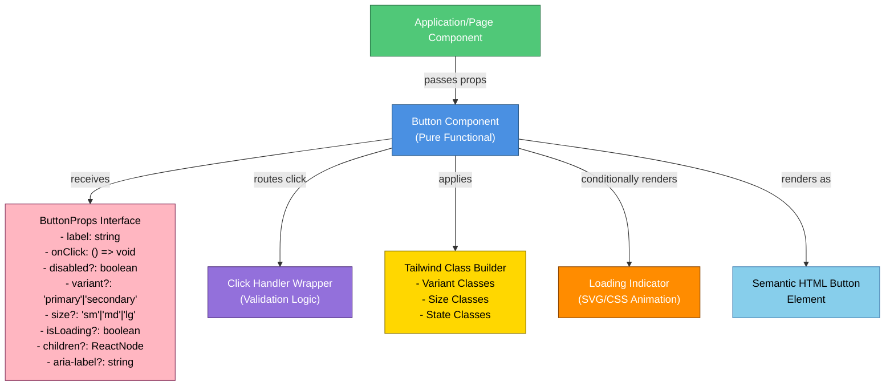
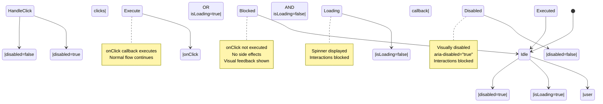

# EPMCDMETST-73456: Button Component Architecture

## Scope and Traceability

**Source requirements:** [01-requirements.md](01-requirements.md), FR-1 through FR-17.

**Scope:** Design a reusable, accessible React Button component that supports multiple variants, sizes, loading states, and standard ARIA attributes. The component is a pure functional component with strict TypeScript typing and no internal state management.

**Required behavior:** The Button component must render as a standard HTML `<button>` element with configurable label text, click handlers, disabled state, visual variants (primary/secondary), size options (sm/md/lg), loading state indicator, and full ARIA support. When disabled or in loading state, the component must prevent onClick execution and display appropriate visual feedback.

**Explicit exclusions:** 
- Button styling specifics beyond variant application (exact color values are implementation details)
- Form submission behavior (native HTML form integration is out of scope)
- Advanced keyboard navigation (standard HTML button behavior is sufficient)
- Internationalization (i18n) for button labels
- Animation effects beyond loading state indicator
- Custom className extension (styling is entirely variant-based per requirements)

## Recommendation

Implement a pure functional React component using React 18+ and TypeScript with strict type checking. The Button component shall:

1. **Core Structure:** Export a single default Button component and supporting type definitions (ButtonProps interface, ButtonVariant type, ButtonSize type).

2. **Props Interface:** Define ButtonProps with all required and optional properties:
   - Required: `label` (string), `onClick` (() => void)
   - Optional: `disabled` (boolean, default false), `variant` ('primary' | 'secondary', default 'primary'), `size` ('sm' | 'md' | 'lg', default 'md'), `isLoading` (boolean, default false), `children` (ReactNode), `aria-label` (string), `aria-disabled` (boolean)

3. **Event Handling:** Implement a click handler wrapper that:
   - Prevents onClick execution when `disabled` prop is true
   - Prevents onClick execution when `isLoading` prop is true
   - Executes the callback only when both disabled and isLoading are false

4. **Styling Approach:** Use CSS Modules for scoped component styling:
   - Create Button.module.css file with scoped classes
   - Variant-specific classes (primary: solid background, secondary: outlined/bordered)
   - Size-specific classes (sm/md/lg for padding, font size, height)
   - Disabled state classes (reduced opacity, cursor-not-allowed)
   - Loading state classes (opacity reduction, cursor-not-allowed)
   - No global style pollution; each button imports its own styles

5. **Loading State:** Implement a loading indicator strategy:
   - Display an inline spinner/loader component or Tailwind-based animation
   - Disable all interactions (both via onClick prevention and disabled HTML attribute)
   - Optionally show loading text or hide label text during loading

6. **Accessibility:** Ensure compliance with WCAG standards:
   - Support `aria-label` for custom button labels
   - Set `aria-disabled="true"` when button is disabled
   - Set `aria-disabled="true"` when button is in loading state
   - Maintain semantic HTML button structure
   - Provide clear visual feedback for disabled and loading states

7. **Component Interaction:** The button handles these scenarios:
   - **Normal state:** renders clickable with label, calls onClick on click
   - **Disabled state:** renders visually disabled, prevents onClick, sets HTML disabled attribute
   - **Loading state:** renders with spinner, prevents onClick, sets aria-disabled
   - **Disabled + Loading:** loading takes precedence in disabled state
   - **Variant application:** applies appropriate Tailwind classes based on variant prop
   - **Size scaling:** applies appropriate Tailwind classes based on size prop

## Deployment Boundaries

**System boundary:** The Button component is a self-contained UI component with no external dependencies beyond React 18+. It operates entirely within the browser's DOM as a controlled React component using CSS Modules for styling.

**Integration boundaries:** 
- Input boundary: accepts React component props following ButtonProps interface
- Output boundary: renders semantic HTML button element and calls onClick callback
- State boundary: component is stateless; no internal state management required
- Styling boundary: CSS Modules with scoped classes (no Tailwind, no global styles, no CSS-in-JS)

**Deployment constraints:**
- React 18+ must be available in the application
- CSS Modules must be supported by the build system (already configured)
- TypeScript with `noImplicitAny: true` must be enforced during compilation
- Component is consumable in any React application using TypeScript or JavaScript

## Key Components

| Component | Responsibilities and Interfaces | Owned Data |
| --- | --- | --- |
| Button Component | Render semantic HTML button element; handle click events with conditional execution based on disabled/loading state; apply variant and size-based Tailwind classes; set ARIA attributes; prevent default interactions when disabled or loading. Interface: ButtonProps (input) → HTML button element (output). | No persistent data. Receives all state via props. |
| Variant Styling | Map variant prop ('primary' \| 'secondary') to Tailwind CSS utility classes. Apply solid background for primary variant; outline/border for secondary variant. | Mapping of variant to class strings. |
| Size Styling | Map size prop ('sm' \| 'md' \| 'lg') to Tailwind CSS utility classes. Apply padding, font-size, and height classes accordingly. | Mapping of size to class strings. |
| State Styling | Apply disabled-state classes (opacity, cursor) and loading-state classes. Set HTML disabled attribute and aria-disabled when appropriate. | Conditional class application logic. |
| Click Handler Wrapper | Intercept click events; validate disabled and isLoading flags; execute onClick callback only when both are false. | Event handling logic. |
| Loading Indicator | Display visual spinner/loader when isLoading prop is true. Can be a simple SVG spinner or CSS-based animation. | Visual representation of loading state. |

## Technology Choices

| Choice | Rationale and Trade-offs | Alternative |
| --- | --- | --- |
| **React 18+ Functional Component** | Requirement FR-17 specifies pure/stateless functional component using React 18+. Functional components with hooks are the modern React standard and provide better composition and testing. No trade-offs as this is a requirement. | Class components (rejected per requirement). |
| **TypeScript with Strict Type Checking** | Requirement FR-16 mandates strict TypeScript with noImplicitAny: true. Type safety prevents prop misuse and improves IDE support. Performance overhead is negligible. | JavaScript or loose TypeScript (rejected per requirement). |
| **Props Interface (ButtonProps)** | Explicit interface provides clear contract, IDE autocomplete, and compile-time validation. Extends HTMLButtonElement attributes (omitting className per requirements). | Using spread props or any type (rejected due to strict TypeScript requirement). |
| **CSS Modules for Styling** | Scoped styling prevents global style pollution and name conflicts. No dependencies or configuration needed beyond existing build system. Atomic CSS classes are reusable and maintainable. Zero-setup approach. | Tailwind CSS (requires root config), styled-components (requires library), or inline styles (no reuse). |
| **Click Handler Wrapper Function** | Provides single point of control for onClick prevention. Cleanly separates event logic from component rendering. Prevents user confusion by consistently blocking clicks when disabled/loading. | No trade-offs; this is a requirement (FR-6, FR-13). |
| **Inline Loading Indicator** | Simple spinner display during loading state. Can be a small SVG or CSS animation. Keeps component self-contained. | External loader component (would require prop passing and dependency management). |
| **HTML Disabled Attribute + aria-disabled** | Native HTML disabled attribute handles keyboard navigation and form state. aria-disabled provides semantic information to assistive technologies. Both are WCAG compliant. | Using only CSS for disabled appearance (less accessible). |
| **No Internal State Management** | Requirement FR-17 specifies pure/stateless component. All state is passed via props. Simplifies testing and reasoning about component behavior. | Using useState for internal state (rejected per requirement). |

## Diagrams

### Component Structure Diagram



### State Transition Diagram



### End-to-End Component Usage Flow

```
1. Application Component imports Button and defines onClick handler
2. Application renders Button with ButtonProps (label, onClick, variant, size, isLoading, disabled, aria-label)
3. Button Component receives props
4. Button Component renders:
   a. Applies base Tailwind classes (focus, transitions, cursor)
   b. Applies variant-specific Tailwind classes (primary solid bg / secondary outlined)
   c. Applies size-specific Tailwind classes (sm/md/lg padding, font-size, height)
   d. If disabled=true: apply disabled state classes, set HTML disabled attribute
   e. If isLoading=true: apply loading state classes, display loading spinner, set aria-disabled
   f. Set aria-label if provided
   g. Render semantic <button> element
5. User interacts with button:
   a. Click event fires
   b. Click handler wrapper checks: if (disabled || isLoading) → prevent onClick execution
   c. If not disabled and not loading → execute onClick callback
   d. Callback completes, component remains rendered for next interaction
6. Parent component updates isLoading prop (async operation complete)
   a. Component re-renders with isLoading=false
   b. Loading spinner hidden, button re-enabled
   c. Component ready for next user interaction
```

## Data Stores and Integrations

**No persistent data stores:** The Button component is stateless and has no data storage requirements. All state is managed by the parent component.

**Integration points:**
- **Input Integration:** Receives props from parent React component via standard prop-passing mechanism
- **Output Integration:** Calls onClick callback provided by parent; callback implementation is parent's responsibility
- **Styling Integration:** Consumes Tailwind CSS utility classes (must be available in project's CSS pipeline)
- **DOM Integration:** Renders as semantic HTML button element; accessible to browser accessibility tree

**No external API calls, database access, or server communication required.**

## Trust Boundaries and Security

**Trust boundary (Component Input):**
- Props are passed from parent component; assumed to be valid React component props
- label prop is passed directly to button element (safe, text content only)
- onClick callback is a user-provided function; component does not inspect or validate callback implementation
- aria-label is passed directly to HTML attribute (safe, text content only)

**Security considerations:**
- Component performs no server communication; no CSRF or injection risks
- No sensitive data handling required
- Label and aria-label are treated as plain text (no HTML interpretation)
- No authentication or authorization logic needed

**Accessibility (WCAG Compliance):**
- Semantic HTML button element ensures keyboard navigation works (space/enter)
- aria-disabled attribute correctly communicates disabled state to screen readers
- aria-label provides alternative text for assistive technologies
- Visual disabled state (opacity, cursor) supports users with visual disabilities
- Loading state clearly indicates to all users that interaction is blocked

## NFR Coverage

| Non-Functional Requirement | Architecture Response |
| --- | --- |
| NFR-1: React 18+ | Component implemented as pure functional component using React 18+ syntax and hooks compatibility |
| NFR-2: TypeScript Strict | All props, types, and return types explicitly declared; noImplicitAny: true enforced; no `any` type usage |
| NFR-3: Pure Stateless Component | Component receives all state via props; no useState, useReducer, or useRef for state management |
| NFR-4: Tailwind CSS | All styling via Tailwind utility classes; no inline styles or CSS-in-JS; integrated into project's CSS pipeline |
| NFR-5: ARIA Support | Supports aria-label and aria-disabled attributes; sets aria-disabled="true" when disabled or loading |
| NFR-6: Accessibility | Semantic HTML structure; visual disabled/loading feedback; keyboard navigation via native button behavior |

## Clarified Decisions

**Decision 1: Default Variant Value**
- **Question:** Should the Button have a default variant when the `variant` prop is not provided, or should it be required?
- **Decision:** Default variant is 'primary'. This provides a sensible default for the most common use case while allowing optional override.
- **Rationale:** Most buttons in applications are primary actions; requiring the prop in every case adds verbosity without benefit.

**Decision 2: Default Size Value**
- **Question:** Should the `size` prop have a default value (e.g., 'md'), or is it optional without a default?
- **Decision:** Default size is 'md'. This provides a sensible middle-ground default that suits most use cases.
- **Rationale:** Medium is the most common button size; having a default reduces prop requirement without losing flexibility.

**Decision 3: Loading Indicator Implementation**
- **Question:** What specific loading indicator/spinner design should be displayed when `isLoading` is true?
- **Decision:** Use an inline SVG spinner or Tailwind CSS animation (implementation choice). The spinner should be small, inline, and positioned appropriately based on size variant.
- **Rationale:** Inline spinner is consistent with the component's self-contained design and doesn't require external dependencies. SVG or CSS animation both meet this requirement.

**Decision 4: Disabled Styling Strategy**
- **Question:** What specific visual styling should indicate a disabled state? Should both reduced opacity and cursor-not-allowed be applied, or is one preferred?
- **Decision:** Apply both reduced opacity (e.g., opacity-50 or opacity-60) AND cursor-not-allowed. This provides multiple visual cues for accessibility.
- **Rationale:** Layering multiple cues ensures users with different visual abilities can recognize the disabled state. Opacity reduction is visible, cursor-not-allowed is intuitive.

**Decision 5: HTML Props Extension**
- **Question:** The ButtonProps interface uses `Omit<ButtonHTMLAttributes<HTMLButtonElement>, 'className'>`. Should custom className support be re-added through a custom prop?
- **Decision:** Do NOT add custom className support. Styling is entirely variant-based per requirements. Users customize via variant and size props only.
- **Rationale:** This enforces consistency and prevents style conflicts. Variants provide the full customization needed; arbitrary className override would break design system integrity.

**Decision 6: Type vs Interface Usage**
- **Question:** The code contract mentions using `type ButtonVariant` and `type ButtonSize`. Should these remain as types even though the instruction says "All props must be explicitly typed using an interface"?
- **Decision:** Use `interface ButtonProps` for the main props interface. Use `type ButtonVariant` and `type ButtonSize` for the union types (this is idiomatic TypeScript).
- **Rationale:** Interfaces are for object shapes; types are for union/literal types. This follows TypeScript conventions while maintaining strict typing.

## Assumptions

1. **React 18+ is available:** The application uses React 18 or later, ensuring compatibility with modern React patterns and hooks.

2. **Tailwind CSS is configured:** The project has Tailwind CSS properly configured in its build pipeline, with utility classes available to components.

3. **TypeScript compilation uses strict mode:** The project compiles TypeScript with `noImplicitAny: true` and other strict flags enabled.

4. **Parent component manages async state:** When implementing loading behavior, the parent component is responsible for managing async operations and updating the `isLoading` prop accordingly.

5. **Standard HTML button behavior is acceptable:** The component relies on native HTML button keyboard navigation and form submission. No custom keyboard handling is required.

6. **ARIA attributes are sufficient for accessibility:** No custom accessibility patterns beyond standard ARIA and semantic HTML are needed.

7. **Tailwind CSS animation utilities are available:** For the loading spinner, Tailwind's animation utilities (spin, pulse, etc.) can be used without additional CSS files.

## Risks

1. **Risk: Tailwind CSS build configuration:** If Tailwind CSS is not properly configured in the project build pipeline, Tailwind utility classes may not be generated or available. 
   - Mitigation: Verify Tailwind configuration before component implementation; ensure all required utility classes are included in the CSS pipeline.

2. **Risk: TypeScript strict mode enforcement:** If the project does not enforce strict TypeScript checking, type safety benefits are reduced.
   - Mitigation: Ensure the project's tsconfig.json includes `noImplicitAny: true` and other strict flags.

3. **Risk: Variant styling consistency:** Without a centralized style guide, variant implementations may be inconsistent across different projects using this component.
   - Mitigation: Document exact Tailwind classes for each variant in the implementation guide.

4. **Risk: Loading indicator UX:** If the loading indicator is too subtle, users may not recognize that the button is in a loading state.
   - Mitigation: Use a clear, animated spinner; consider adding loading text or disabling the label.

5. **Risk: Accessibility testing:** Even with ARIA attributes, real-world accessibility testing with screen readers is essential.
   - Mitigation: Perform testing with screen readers (NVDA, JAWS, VoiceOver) during verification phase.

6. **Risk: Browser compatibility:** Older browsers may not support all Tailwind CSS features or CSS animation.
   - Mitigation: Document minimum browser requirements; test against target browsers.

7. **Risk: onClick callback complexity:** Parent components may pass complex callbacks that cause performance issues.
   - Mitigation: Document that onClick should be stable/memoized; encourage use of useCallback in parent components.

## Open Questions

None. All material ambiguities have been clarified and decisions accepted during the design phase (see Clarified Decisions section above).

## Requirement-to-Component Mapping

| Requirement | Component/Decision | Coverage |
| --- | --- | --- |
| FR-1 (Render HTML button) | Button Component renders semantic `<button>` element | ✓ Fully addressed |
| FR-2 (label prop) | ButtonProps.label: string | ✓ Fully addressed |
| FR-3 (onClick prop) | ButtonProps.onClick: () => void | ✓ Fully addressed |
| FR-4 (Execute onClick) | Click Handler Wrapper executes when not disabled/loading | ✓ Fully addressed |
| FR-5 (Disabled visual) | State Styling applies opacity/cursor classes | ✓ Fully addressed |
| FR-6 (Prevent onClick when disabled) | Click Handler Wrapper checks disabled flag | ✓ Fully addressed |
| FR-7 (variant prop) | ButtonProps.variant: 'primary' \| 'secondary' (optional, default 'primary') | ✓ Fully addressed |
| FR-8 (Apply variant styles) | Variant Styling maps to Tailwind classes | ✓ Fully addressed |
| FR-9 (children prop) | ButtonProps.children: ReactNode (optional) | ✓ Fully addressed |
| FR-10 (isLoading prop) | ButtonProps.isLoading: boolean (optional, default false) | ✓ Fully addressed |
| FR-11 (Display loading indicator) | Loading Indicator renders when isLoading=true | ✓ Fully addressed |
| FR-12 (Disable during loading) | State Styling applies loading state classes | ✓ Fully addressed |
| FR-13 (Prevent onClick during loading) | Click Handler Wrapper checks isLoading flag | ✓ Fully addressed |
| FR-14 (ARIA support) | Button Component sets aria-disabled and aria-label attributes | ✓ Fully addressed |
| FR-15 (size prop) | ButtonProps.size: 'sm' \| 'md' \| 'lg' (optional, default 'md') | ✓ Fully addressed |
| FR-16 (TypeScript strict) | All types explicitly declared; noImplicitAny: true enforced | ✓ Fully addressed |
| FR-17 (Pure functional React 18+) | Button Component is pure functional component; no internal state | ✓ Fully addressed |

---

**Architecture Design Status:** Complete and ready for implementation planning.

**Diagram Note:** The Mermaid diagrams above are rendered as text source. Visual rendering validation is not performed in this architecture phase.

